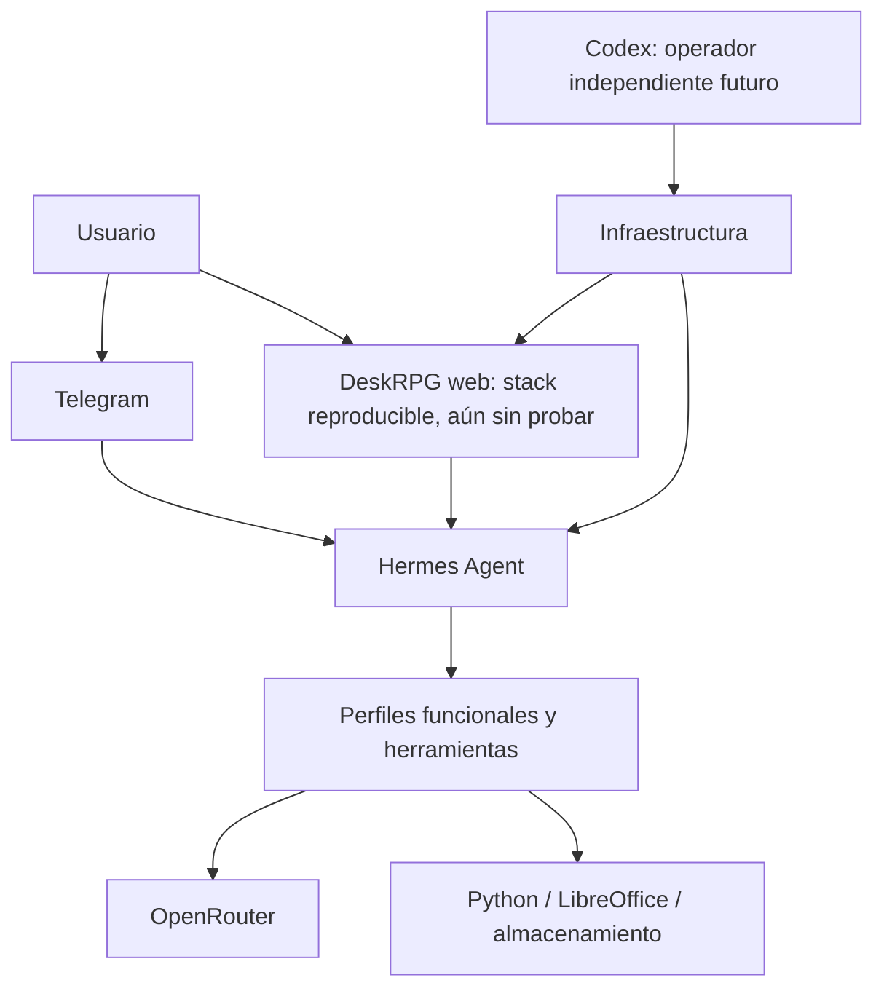

# Ariel Agent OS

**Repositorio:** agentes-IA-de-Ariel-Romero  
**Propósito:** oficina virtual de ingeniería con agentes especializados y herramientas reproducibles.  
**Corte del estado documentado:** 21 de noviembre de 2026.  
**Estado:** piloto operativo reportado sobre VPS Hostinger; instalador para un VPS nuevo documentado y aún no probado.

> **AVISO:** este repositorio se encuentra PÚBLICO al momento de la carga inicial. No guardar secretos, credenciales, backups, expedientes de empresa ni información interna sin autorización. Cambiarlo a privado antes de llevar configuraciones reales.

## Instalación en un VPS nuevo

El repositorio incluye un instalador de una línea para Debian/Ubuntu. Configura DeskRPG + Hermes + el plugin compatible + HTTPS y prepara generación de imágenes vía OpenRouter. Requiere dominio y clave OpenRouter, y todavía no se ha probado en un VPS limpio. No restaura datos ni perfiles del VPS actual.

~~~bash
curl -fsSL https://raw.githubusercontent.com/Arielromero13/agentes-IA-de-Ariel-Romero/main/scripts/install-vps.sh | sudo bash
~~~

Guía: [instalación de nuevo VPS](docs/instalacion-nuevo-vps.md).

## Operación actual (reportada; validar en servidor)

- Hermes Agent alojado en VPS Hostinger.
- Telegram como canal operativo.
- OpenRouter como proveedor de modelos; modelo efectivo por perfil sujeto a verificación.
- Python/LibreOffice empleados en flujos experimentales de documentos.
- Agentes históricos «Juan» (protecciones) y «Alma» (puesta a tierra), con pruebas y cambios previos.
- Casos trabajados: informes de mediciones, COMTRADE/protecciones, calidad de energía Fluke 1748, informes de obras y documentos técnicos.
- No hay evidencia de que DeskRPG, los diez perfiles funcionales, Codex en servidor o un backup restaurado estén ya desplegados.

## Arquitectura objetivo

**VPS actual:** el piloto DeskRPG sigue con la incidencia descrita en [su evaluación](docs/deskrpg.md). El instalador del repositorio prepara un VPS nuevo; no altera ni reemplaza el piloto. La migración requiere backup y restauración verificados.

## Documentación de trabajo

- [Estado y arquitectura](docs/arquitectura.md)
- [Catálogo de agentes](docs/agentes.md)
- [Flujos y pruebas](docs/flujos-y-pruebas.md)
- [Runbook de respaldo del VPS](docs/backup-vps.md)
- [DeskRPG: evaluación y piloto](docs/deskrpg.md)
- [Seguridad](docs/seguridad.md)
- [ADR / decisiones](docs/decisiones.md)
- [Hoja de ruta](ROADMAP.md)
- [Plantillas](templates/)
- [Guía para agentes de código](AGENTS.md)

## Reglas innegociables

1. Separar instalado, reportado, verificado, experimental y planificado.
2. No inventar mediciones, fuentes, porcentajes ni normas.
3. Conservar originales y registrar evidencia de cada prueba.
4. Scripts versionados y validados antes de reutilizarlos.
5. Menor privilegio; revisión técnica independiente; aprobación humana final.
6. No eliminar VPS ni perfiles anteriores antes de validar reemplazos.
