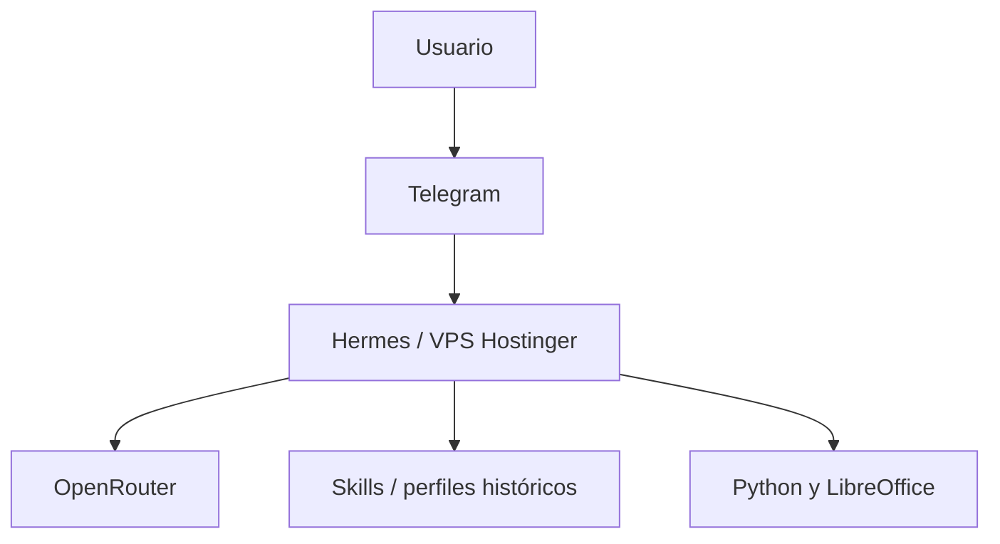
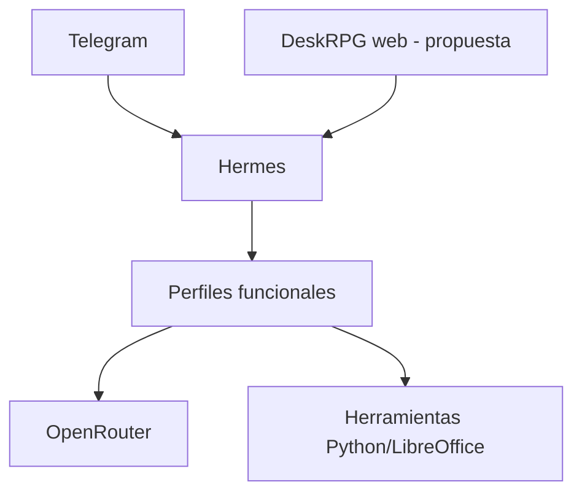

# Arquitectura vigente, propuesta y alcance

## Estado reportado

Operación reportada de Telegram/Hermes/OpenRouter y pruebas técnicas de informes; no se ha auditado el estado *actual* del servidor en esta intervención. Históricos Juan/Alma tienen configuraciones de trabajo que deben conservarse. Los cambios de modelo anteriormente probados no se extrapolan automáticamente a todos los perfiles.

## En el VPS actual: piloto próximo

Primero: respaldo e inventario. Después: perfiles en paralelo + DeskRPG aislado + pruebas sin interrumpir operación.

## En Mini PC: objetivo posterior
El mismo stack se migraría a Linux doméstico con OpenRouter como inferencia principal. Codex CLI podría administrar código/infraestructura mediante un acceso autorizado independiente; instalarlo no concede automáticamente a este chat control sobre el servidor.

## Estado por componente

| Componente | Estado documental |
|---|---|
| VPS Hostinger + Hermes | Operativo reportado |
| Telegram + OpenRouter | Operativo reportado |
| Python + LibreOffice | Uso/instalación reportados; auditar |
| Perfiles AG-01 a AG-10 | Diseño, no desplegados |
| DeskRPG | Evaluación y piloto pendiente |
| Backup Google Drive | Planificado, sin ejecución |
| Codex sobre Mini PC | Propuesto |
| Mini PC | Por comprar |
| Home Assistant y CCTV | Futuro |
| n8n | Excluido fase inicial |

## Decisiones de diseño
- El LLM genera interpretación y comunicación; Python procesa números, gráficos y archivos con pruebas.
- Las funciones no implican contenedores ni modelos dedicados obligatorios.
- No confundir visualización de empleados DeskRPG con subagentes reales ni afirmar soporte de una opción sin verificar versión.
- Privilegios mínimos, auditoría independiente y trazabilidad.
- La seguridad del navegador corporativo se rige por políticas de TI y autorización de datos.
